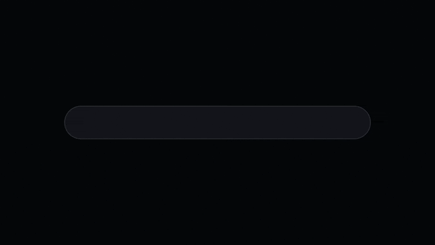
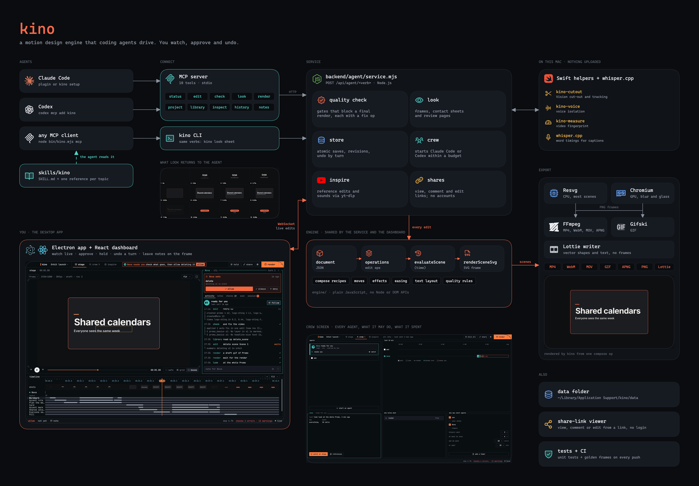

<div align="center">

# kino

**An open-source motion design engine that coding agents drive.**<br>
Claude Code, Codex or any MCP client makes the video. You watch, approve, undo and leave notes.

[](https://github.com/bayshores/kino/actions/workflows/ci.yml)


</div>

## Made with kino

<table>
<tr>
<td colspan="2"></td>
</tr>
<tr>
<td colspan="2"><b>Launch film.</b> A typed prompt (<code>type-on</code>), the real dashboard as a tilted plane (<code>ui-plane</code>), one card lifted out of it (<code>lift-focus</code>), a word roll and a logo settle (<code>logo-settle</code>).</td>
</tr>
<tr>
<td width="50%"></td>
<td width="50%"></td>
</tr>
<tr>
<td><b>Footage spot.</b> Eight live-action shots. The skater is cut out on this Mac (<code>cut_out</code>) so the title stands behind him (<code>masked-type</code>), then a <code>whip-pan</code> and a <code>zoom-blur</code>.</td>
<td><b>Montage open.</b> One shot breaks into a ring of every clip (<code>tile-ring</code>) while the title flies together (<code>assemble</code>).</td>
</tr>
</table>

Each clip is a kino final render made through the `kino` command line, the same verbs an agent
calls. Footage: free stock clips from [Mixkit](https://mixkit.co) (Mixkit License); the brand is
made up.

## What you get

- **Agents do the editing.** Ten MCP tools, a `kino` command line and a skill file. The whole
  tool list is capped at 5,800 tokens, and no answer is over about 8,000. kino can also start
  Claude Code or Codex agents from your own installs, within a budget you set (the crew screen).
- **A quality checker.** 27 errors that block a final render and 104 warnings (reading time,
  contrast, flashing, safe zones, timing), each with a fix the agent can apply.
- **Building blocks.** One `compose` op builds a whole promo from beats and a brand kit: 24
  recipes, 3 transitions, 5 looks, a 6×6 slot grid, relative timing, variants and templates.
  The `move` op adds one of 58 designed set pieces (whip pan, zoom-through, word-by-word captions).
- **The full engine.** Layers, keyframes and easings, text animations, 62 effects, masks,
  components, templates, captions, beat detection, and bulk create from a CSV.
- **Exports.** MP4, WebM, MOV (ProRes 4444, also transparent), GIF, APNG, PNG, PNG sequences and
  Lottie.
- **Footage.** Imported videos are split into shots. `look source` shows a clip's whole frame
  with its crop, and a storyboard (`board`) lists every shot for you to approve before the build.
- **Sound.** Volume fades, ducking under a voice-over, voice isolation on your computer, and a
  limiter on the exported mix.
- **Local and private.** No signup, login or billing. Sharing uses view, comment and edit links
  you can revoke.

## Quick start

You need **Node.js 22+**, **FFmpeg** 5.1 or newer (with the `scdet` and `signalstats` filters)
and **Gifski**:

```sh
brew install ffmpeg gifski
npm install          # includes Electron: exports with effects use its Chromium
npm run desktop      # builds and opens the Mac app
```

| Command | What it does |
|---|---|
| `npm run desktop` | The Mac app (Electron) with its own local server |
| `npm run dev` | Browser development path: http://127.0.0.1:4173 (the server runs on port 4781) |
| `npm run build && npm start` | Production build at http://127.0.0.1:4781 |
| `npm run desktop:pack` | Builds `release/mac-arm64/kino.app` (run `npm run desktop:tools` once first) |

The app opens on the dashboard, which shows what the agent is doing. Nobody edits by hand: you
answer approvals and stops, leave notes on the frame, hold agent writes, or undo an agent's turn.
Projects are saved in `~/Library/Application Support/kino/data` (Mac app) or `.local/data`
(browser path). Settings, data folders and rendering: [docs/running.md](docs/running.md).

## Connect an agent

Start kino first. Then, in this folder:

```sh
node bin/kino.mjs setup      # add --dry-run to see the plan without changing anything
```

`setup` finds Claude Code and Codex, asks before every change, adds kino's MCP server and copies
the kino skill. It never opens an agent's login or credential files.

- **Claude Code plugin:** `/plugin marketplace add /path/to/kino`, then `/plugin install kino@kino`
- **Codex:** `codex mcp add kino -- node "$PWD/bin/kino.mjs" mcp`. Codex started in this folder
  finds the skill at `.agents/skills/kino`.
- **Any other MCP client:** run `node bin/kino.mjs mcp` as a stdio server.

The same verbs work from a terminal (run `npm link` once to get the `kino` command):

```sh
kino status
kino edit '[{"op":"update_layer","layer":"title","properties":{"fill":"#ff5500"}}]'
kino look sheet                                  # prints the path of the saved PNG
kino render start quality=final && kino render wait
```

The ten tools, the checker and the CLI: [docs/connect-an-agent.md](docs/connect-an-agent.md).
Agent instructions: [skills/kino/SKILL.md](skills/kino/SKILL.md).

## How it works



Edit it at [excalidraw.com](https://excalidraw.com) by opening [docs/architecture.excalidraw](docs/architecture.excalidraw).

| Folder | What it holds |
| --- | --- |
| `engine/` | The motion engine both sides share: document model, operations, animation, rendering, recipes, quality rules. Plain JavaScript, no Node or DOM APIs |
| `backend/` | The Node service: agent API (`backend/agent/`), MCP server, export, media, store |
| `frontend/` | The React dashboard the app window shows (`frontend/dashboard/`) and the share-link viewer |
| `desktop/` | The Electron shell that starts the service and opens the window |
| `bin/` | The `kino` CLI |
| `skills/kino/` | The agent skill |

Tests sit next to the code they test. Which file does what: [docs/code-map.md](docs/code-map.md).

## Checks

```sh
npm test                            # every test, including the golden frames
npm run build                       # production build
npm run mcp:budget                  # size of the tool list an agent loads
npm run eval -- --brief promo-01    # a real agent run on one test brief
```

More: [docs/testing.md](docs/testing.md). Every feature and its evidence: [COMPATIBILITY.md](COMPATIBILITY.md).

## Status

Built: the agent tools, checker, building blocks, dashboard, fast rendering, audio and captions,
the brief from the chat, stops and the storyboard, and live agent presence. The plan and what is
left: [docs/agent-first-plan.md](docs/agent-first-plan.md).

**Not done or not verified yet:** VoiceOver; 27 of 93 rows in the
[reachability audit](COMPATIBILITY.md#reachability-audit) (16 have a working agent path without every
combination proven, 11 are keyboard, focus or Mac-system behavior no agent operation
reproduces); Apple notarization and first launch on a fresh Mac (the app is ad-hoc signed);
direct sign-in to AI providers (agents keep their own login); moving projects between the Mac
app and browser data folders.

## Docs

| Doc | What it covers |
|---|---|
| [docs/running.md](docs/running.md) | Running from source, data folders, rendering settings, the Mac app |
| [docs/connect-an-agent.md](docs/connect-an-agent.md) | Agent setup, the ten tools, quality checks, the CLI |
| [docs/testing.md](docs/testing.md) | Tests, golden frames and agent evals |
| [docs/code-map.md](docs/code-map.md) | Which file does what, for a first change |
| [AGENTS.md](AGENTS.md) | Rules and commands for contributors and the coding agents working on kino |
| [docs/agent-first-plan.md](docs/agent-first-plan.md) | The plan, decisions and what is left |
| [docs/bundled-tools.md](docs/bundled-tools.md) | The FFmpeg, Gifski, kino-voice and kino-cutout builds inside the Mac app |
| [COMPATIBILITY.md](COMPATIBILITY.md) | The evidence ledger |

## Provenance

The voice cleanup chain (`backend/voice-chain.mjs`), equal-power fades (`engine/animation.js`),
ducking for any sound (`engine/audioDucking.js`), shot color match (`engine/effects/colorMatch.js`), the
speed-matched joins of the `speed_jump` fix (`engine/quality/rules/motion.js`), the text range
selector and its wiggly shape (`engine/textTiming.js`), the octave wiggle noise (`engine/behavior.js`), move alignment
(`engine/blocks/move.js`), the spring and back-out easings (`engine/easing.js`) and the morph cut's
optical flow (`engine/morphCut.js`) are ported from the
ArtCraft Team's FilmCraft, EffectCraft and SoundCraft ([github.com/storytold](https://github.com/storytold)),
MIT OR Apache-2.0, © the ArtCraft authors; each ported piece names its source file.

## License

[AGPL-3.0](LICENSE). Inter, Montserrat and Noto Serif keep their SIL Open Font Licenses
([assets/fonts](assets/fonts/README.md)). Gifski is a separate tool under the
[AGPL](https://github.com/ImageOptim/gifski/blob/main/LICENSE). Voice isolation uses the DPDFNet
model by Ceva and sherpa-onnx by k2-fsa (both Apache-2.0, the model downloaded on first use),
ONNX Runtime (MIT) and the RNNoise model (BSD-3-Clause) ([assets/voice](assets/voice/README.md)).
The test clip from the Sintel trailer is © Blender Foundation | durian.blender.org, under
[CC BY 3.0](https://creativecommons.org/licenses/by/3.0/) ([tests/fixtures/footage/SOURCES.md](tests/fixtures/footage/SOURCES.md)).
